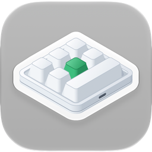

<p align="center"></p>

<h1 align="center">أداة إعداد لوحات مفاتيح الماكرو لأجهزة Mac</h1>

<p align="center">
  
  
  
  <a href="../LICENSE"></a>
</p>

<p align="center"><a href="../README.md">English</a> · <a href="README.ko.md">한국어</a> · <b>العربية</b> · <a href="README.de.md">Deutsch</a> · <a href="README.es.md">Español</a> · <a href="README.es-419.md">Español (Latinoamérica)</a> · <a href="README.fr.md">Français</a> · <a href="README.id.md">Bahasa Indonesia</a> · <a href="README.it.md">Italiano</a> · <a href="README.ja.md">日本語</a> · <a href="README.pl.md">Polski</a> · <a href="README.pt-BR.md">Português (Brasil)</a> · <a href="README.pt-PT.md">Português (Portugal)</a> · <a href="README.ru.md">Русский</a> · <a href="README.th.md">ไทย</a> · <a href="README.vi.md">Tiếng Việt</a> · <a href="README.zh-Hans.md">简体中文</a> · <a href="README.zh-Hant.md">繁體中文</a></p>

تطبيق لنظام macOS يكتب إعدادات المفاتيح على لوحات مفاتيح الماكرو الصغيرة بمنفذ USB — وهي اللوحات التي تُباع بدءًا من مقبض
واحد فقط وحتى 21 مفتاحًا، وبما يصل إلى أربعة مقابض. ولكل مفتاح ولكل إجراء من إجراءات المقبض (التدوير إلى اليسار، والضغط،
والتدوير إلى اليمين) يضبط التطبيق ضغطات المفاتيح أو مفتاح وسائط أو إجراء ماوس في الطبقات 1–3، ويضبط أيضًا إضاءة لوحة
المفاتيح.

<p align="center"></p>

| لوحة المفاتيح | التخطيط | قراءة الإعدادات | الانتظار | الإضاءة | جُرّبت فعليًا |
|---|---|---|---|---|---|
| `1189:8890` | تحدده أنت — المفاتيح (حتى 12)، والمفاتيح في كل صف، والمقابض (حتى 2) | لا | لا | ثلاثة أوضاع | نعم — 6 مفاتيح ومقبض واحد |
| الشركة المصنعة `1189` أو `514C`، المنتج `8840` · `8842` · `8830`–`8833` · `8850` · `8851`، ببرنامج ثابت أحدث | وفق ما تذكره لوحة المفاتيح — 26 تخطيطًا | عند التوصيل | قبل كل ضغطة | وضع واحد، ولون لكل مفتاح من المفاتيح 1–16 | نعم — `514C:8850`، 12 مفتاحًا ومقبضان |
| اللوحات نفسها، ببرنامج ثابت أقدم | وفق ما تذكره لوحة المفاتيح | عند التوصيل | انتظار واحد لكل مفتاح | لون ووضع | لا |
| اللوحات نفسها حين لا تذكر نوعها | تختاره أنت — 26 تخطيطًا | لا | لا | لون ووضع | لا |

لوحة المفاتيح `1189:8890` هي اللوحة التي تعمل معها «MINI KeyBoard»، أداة الشركة المصنعة لنظام Windows؛ أما البقية فهي
اللوحات التي يبحث عنها «MINI_KEYBOARD»، تطبيق الشركة المصنعة متعدد المنصات. ويستخدم التطبيق أوامر كلتا الأداتين. ومعظم
لوحات الفئة الثانية تذكر عدد مفاتيحها ومقابضها والبرنامج الثابت الذي تعمل به، فيرسم التطبيق التخطيط الذي كان سيرسمه
تطبيق الشركة المصنعة؛ أما اللوحة التي لا تذكر ذلك فتحصل على التخطيط الذي تختاره أنت من بين تلك التخطيطات. ولا يعرف تطبيق
الشركة المصنعة لوحة `1189:8890`، ولا ترسم أداتها الخاصة أي شكل، لذا فشكلها الحقيقي غير معروف: تُخبر أنت التطبيق بعدد
مفاتيحها ومقابضها وبعدد المفاتيح في كل صف، فيرسمها بترتيب منظم وفق ذلك.

يتوفر التطبيق بـ 18 لغة — الإنجليزية، والكورية، واليابانية، والصينية (المبسطة والتقليدية)، والألمانية، والإسبانية
(إسبانيا وأمريكا اللاتينية)، والفرنسية، والإيطالية، والبرتغالية (البرازيل والبرتغال)، والبولندية، والروسية،
والإندونيسية، والفيتنامية، والتايلاندية، والعربية — ويتبع إعدادات اللغة في macOS. ويظهر بالإنجليزية في اللغات الأخرى.

الشيفرة المصدرية في هذا المستودع مرخّصة بترخيص MIT. وبعض أجزاء التطبيق الموزَّع ليست ضمن هذه الشيفرة — اسمه وأيقونته.
والأيقونة المعروضة في الأعلى للاطلاع فقط: لا يشملها ترخيص MIT، ولا تتضمنها البنيات التي تُنشأ من هذا المستودع.

## على macOS وWindows وLinux والويب

يتوفر MINIKeyboard في أربع نسخ مبنية على القواعد نفسها — الأوامر نفسها، واللغات الـ 18 نفسها. وتدعم التطبيقات الثلاثة لوحات المفاتيح نفسها، أما نسخة الويب، التي تعمل في المتصفح، فتدعمها جميعًا ما عدا `1189:8890`.

| المستودع | GitHub |
|---|---|
| **MINIKeyboardApple**<br>    | [github.com/hobbyworker/MINIKeyboardApple](https://github.com/hobbyworker/MINIKeyboardApple) |
| **MINIKeyboardWin**<br>    | [github.com/hobbyworker/MINIKeyboardWin](https://github.com/hobbyworker/MINIKeyboardWin) |
| **MINIKeyboardLinux**<br>    | [github.com/hobbyworker/MINIKeyboardLinux](https://github.com/hobbyworker/MINIKeyboardLinux) |
| **MINIKeyboardWeb**<br>    | [github.com/hobbyworker/MINIKeyboardWeb](https://github.com/hobbyworker/MINIKeyboardWeb) |

## التنزيل

التطبيق الموقَّع والموثَّق متاح في صفحة [Releases](https://github.com/hobbyworker/MINIKeyboardApple/releases): افتح
`MINIKeyboard-<version>.dmg` واسحب MINIKeyboard إلى مجلد «التطبيقات». يتحقق التطبيق من وجود تحديثات بنفسه
(الإعدادات ▸ عام)، ويمكنك أيضًا اختيار **التحقق من وجود تحديثات…** من قائمة التطبيق.

## المتطلبات

- نظام macOS 14.0 (Sonoma) أو أحدث
- لا تحتاج لوحة `1189:8890` إلى أي إذن: يكتب التطبيق على واجهة التكوين فيها مباشرةً عبر USB، ولا يقرأ أبدًا ما تكتبه بها.
- تُضبط لوحات المفاتيح الأخرى عبر واجهة USB الأولى فيها، كما يفعل تطبيق الشركة المصنعة. وإذا عدّ macOS تلك الواجهة لوحة
  مفاتيح، فإنه لا يفتحها لأي تطبيق إلا بعد منحه إذن «مراقبة الإدخال»؛ وإلى أن يحدث ذلك، يُعلمك التطبيق بذلك ويعرض عليك
  فتح «الخصوصية والأمن».

## البناء

```sh
make build          # البناء عبر Xcode (التحذيرات تُعامَل كأخطاء)
make package-test   # اختبارات الحزمة — لا يُشغَّل التطبيق
make test           # اختبارات التطبيق، والتطبيق نفسه هو مضيفها
make check          # يفشل إذا تسرّب معرّف فريق إلى ملف المشروع
```

تم التحقق من البناء والاختبار باستخدام Xcode 27.2.

إعدادات التوقيع والهوية ليست في المستودع. قبل أول عملية بناء، انسخ ملف المثال واملأ فيه معرّف فريقك في Apple Developer،
واسمًا للتطبيق، ومعرّف حزمة خاصًا بك. ومن دون هذا الملف يتوقف البناء عند
`Unable to open base configuration reference file ... Signing.xcconfig`.

```sh
cp Signing.xcconfig.example Signing.xcconfig
```

اسم الأيقونة اختياري. ومن دون رسم للأيقونة يحصل التطبيق على الأيقونة العامة للنظام.

التحديثات اختيارية أيضًا. يربط التطبيق [Sparkle](https://sparkle-project.org) عبر Swift Package Manager — ويجلبه Xcode
عند أول عملية بناء — لكنه لا يتحقق من وجود تحديثات إلا إذا حدد `Signing.xcconfig` كلًّا من موجز التحديثات
(`BRAND_FEED_URL`) ومفتاحه العام من نوع EdDSA (`BRAND_FEED_PUBLIC_KEY`). ومن دونهما لا يظهر في التطبيق أي عنصر للتحديثات
في أي مكان.

عندما يفتح Xcode المشروع، يعيد كتابة اسم المنتج داخل المخطط المشترك (`MINIKeyboard.xcodeproj/xcshareddata/xcschemes/`)
ليصبح اسمك أنت. هذا متوقع، ولا داعي لإيداع هذا التغيير.

يستضيف التطبيق نفسه اختباراته. وفي أثناء تشغيلها يبحث التطبيق عن لوحة المفاتيح ويتصل بها كعادته. أما اختبارات الحزمة
فتستخدم بدائل وهمية ولوحات مفاتيح المحاكي، ولا تفتح أي لوحة مفاتيح أبدًا.

تتيح لك قائمة **المحاكي** تجربة التطبيق دون لوحة المفاتيح المعنية: اختر `1189:8890`، أو تخطيطًا ببرنامج ثابت أحدث، أو
لوحة مفاتيح لا تذكر نوعها، فيتصرف التطبيق كأنها موصولة — بالأوامر نفسها، ودون أن يُرسَل أي شيء عبر USB. وفي أثناء استخدام
إحداها، يشير إلى ذلك شريط برتقالي أعلى النافذة، وللرجوع اختر **العودة إلى لوحة مفاتيح USB**. وتتيح بنيات Debug جميع
الأنواع (معرّفات التقارير الأخرى للوحة `1189:8890`، والبرنامج الثابت الأقدم). وتجد في **نافذة ▸ سجل الجهاز** كل تقرير
مكتوب وكل رد.

## الاستخدام

1. وصّل لوحة المفاتيح عبر USB. يعثر عليها التطبيق، ويسأل لوحات الفئة الثانية عن نوعها؛ واللوحة التي تجيب تُقرأ إعداداتها
   فورًا.
2. إذا كانت لوحة المفاتيح لا تذكر شكلها، فسيُطلب منك في المرة الأولى تحديد تخطيطها — أحد تخطيطات تطبيق الشركة المصنعة، أو
   بالنسبة إلى `1189:8890` عدد مفاتيحها والمفاتيح في كل صف ومقابضها — وكيفية وضعها أمامك. ويتذكر التطبيق الأمرين كليهما
   لمعرّف USB هذا. ويمكنك تغييرهما لاحقًا باستخدام **الشكل…** و**تدوير** (⌘T)؛ أما اللوحة التي ذكرت شكلها فيمكن تدويرها
   فقط.
3. اختر طبقة، ثم المفتاح أو إجراء المقبض في رسم لوحة المفاتيح.
4. عيّن له إجراءً:
   - **المفاتيح** — أبقِ مفاتيح التعديل مضغوطة (⌃ ⌥ ⇧ ⌘، والمفاتيح اليمنى منها أيضًا)، ثم انقر المفاتيح؛ فكل نقرة تضيف
     ضغطة. ويحوّل الخيار **مفاتيح التعديل فقط** المفتاحَ إلى مفتاح تعديل. ويعرض **QWERTY** المفاتيح بترتيب لوحة مفاتيح
     كاملة الحجم، و**ABC** في مجموعات؛ ولا يمكن النقر إلا على المفاتيح التي يمكن تعيينها في لوحة المفاتيح.
   - **الوسائط المتعددة**، **الماوس** — يحل كل منهما محل الإجراء السابق للمفتاح.
   - **LED** — إضاءة الطبقة؛ وفي البرنامج الثابت الأحدث، حدد أحد المفاتيح 1–16 لتعيين لون له.
   - **التأخير** — في البرنامج الثابت الذي يحفظ فترات الانتظار.
5. يكتب الأمر **حفظ** (⌘S) ما تغيّر. ويطلب الأمر **قراءة** (⌘R) من لوحة المفاتيح التي تدعم القراءة ما تحمله من إعدادات.

في **الإعدادات** (⌘,) تختار لغة الواجهة (واحدة من اللغات الـ 18، أو لغة النظام) والمظهر الفاتح أو الداكن، وفيها قسم
«حول» الذي يعرض الإصدار وتراخيص البرامج مفتوحة المصدر. وعند وجود موجز للتحديثات (انظر أعلاه)، يظهر
**التحقق من وجود تحديثات…** مباشرةً تحت «الإعدادات…» في قائمة التطبيق.

في **الإعدادات ▸ عام ▸ تجاوز أخطاء البرنامج الثابت** يوجد الخيار **منع تكرار المفاتيح بعد تغيير الإضاءة**، وهو مُفعَّل
افتراضيًا. فبعد حفظ الإضاءة، يكرر البرنامج الثابت في `1189:8890` أول ضغطة للمفتاح بلا توقف — ويحدث الأمر نفسه مع برنامج
الشركة المصنعة — لذا يرسل التطبيق بعد الإضاءة أمر حفظ إضافيًا لا يحتوي على أي مفتاح. وعند إيقاف الخيار، يرسل التطبيق ما
يرسله برنامج الشركة المصنعة فقط. كما أن هذه اللوحة تنسى إضاءتها عند فصلها.

## الهيكل

تقع القواعد في حزمة Swift محلية، موزعة على ثلاث وحدات تتجه اعتمادياتها إلى الداخل — والطبقة التي تمتد إلى الخارج لا
تجتاز الترجمة البرمجية.

```
Packages/MINIKeyboardKit/
├── Sources/Domain/        لوحات المفاتيح، والإجراءات، وعناصر التحكم في كل تخطيط، وما يمكن أن تحمله كل لوحة مفاتيح؛ وبروتوكولات المستودعات؛ وحالات الاستخدام (Foundation فقط)
├── Sources/DataLayer/     أوامر كل لوحة مفاتيح والأرقام التي تُعرَّف بها عناصر التحكم فيها؛ والعثور عليها والكتابة عبر USB (IOUSBHost) أو HID (IOHIDDevice)؛ ولوحات مفاتيح المحاكي
├── Sources/Presentation/  نماذج العرض والقيم التي ترسمها الشاشات — هندسة التخطيطات، وجداول المفاتيح والألوان (Observation، دون SwiftUI)
└── Tests/                 Swift Testing — بايتات كل أمر، والتخطيطات، والتعديلات، والمحرر
MINIKeyboard/
├── App/                   نقطة دخول التطبيق وقوائمه، وجذر التركيب (composition root — الملف الوحيد الذي يرى Domain وDataLayer)، والتحديثات (Sparkle)، والتراخيص
├── Views/                 SwiftUI (يستورد Presentation فقط) — لوحة المفاتيح كما هي موضوعة، وصفحات الإجراءات، وورقة التخطيط، وسجل الجهاز؛ Settings/
├── Resources/Licenses/    تراخيص البرامج مفتوحة المصدر، وتظهر في الإعدادات ▸ حول
└── Localizable.xcstrings  en (اللغة المصدر)، ar، de، es، es-419، fr، id، it، ja، ko، pl، pt-BR، pt-PT، ru، th، vi، zh-Hans، zh-Hant
MINIKeyboard-Info.plist    مفاتيح Info.plist التي لا يستطيع Xcode توليدها — موجز Sparkle ومفتاحه، وسطر حقوق النشر
MINIKeyboardTests/         مبدّل التحديثات، والتراخيص، وقائمة التطبيق
```

المعيار هو صفر تحذيرات في Swift 6. تُصلَح التحذيرات ولا تُعطَّل.

## القيود

- جُرّبت الكتابة حتى الآن على لوحتي مفاتيح: لوحة `1189:8890` بستة مفاتيح ومقبض واحد — وقد تبيّن أن لها طبقة واحدة فقط، فأيًّا
  كانت الطبقة التي تكتب فيها، يذهب ما تكتبه إلى المكان نفسه — ولوحة `514C:8850` باثني عشر مفتاحًا ومقبضين، ببرنامج ثابت
  أحدث. أما لوحات المفاتيح الأخرى فيُكتب عليها كما يكتب عليها تطبيق الشركة المصنعة؛ وتثبّت الاختبارات البايتات، لكن لم
  تُجرَّب أي منها بعد.
- لا تستطيع لوحة `1189:8890`، ولا لوحات المفاتيح التي لا تذكر نوعها، الإبلاغ عن إعداداتها، لذا لا يعرض التطبيق إلا ما
  ضُبط فيه.
- تُفتح لوحة مفاتيح واحدة في كل مرة. وعند توصيل عدة لوحات، تختار اللوحة المطلوبة بالزر المجاور لحالة الاتصال؛ ويفتح
  التطبيق اللوحة التي اختيرت في المرة السابقة، وإلا فأول لوحة يعثر عليها، مع تقديم لوحة `1189:8890` على غيرها.
- لا يتوفر تحريك الماوس ولا السحب.
