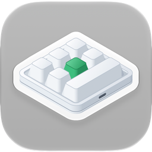

<p align="center"></p>

<h1 align="center">Configurador de teclados de macro para Mac</h1>

<p align="center">
  
  
  
  <a href="../LICENSE"></a>
</p>

<p align="center"><a href="../README.md">English</a> · <a href="README.ko.md">한국어</a> · <a href="README.de.md">Deutsch</a> · <a href="README.es.md">Español</a> · <a href="README.fr.md">Français</a> · <a href="README.id.md">Bahasa Indonesia</a> · <a href="README.it.md">Italiano</a> · <a href="README.ja.md">日本語</a> · <a href="README.pl.md">Polski</a> · <b>Português (Brasil)</b> · <a href="README.vi.md">Tiếng Việt</a> · <a href="README.zh-Hans.md">简体中文</a> · <a href="README.zh-Hant.md">繁體中文</a></p>

Um app para macOS que grava as configurações das teclas em pequenos teclados de macro USB. Eles são vendidos em
vários tamanhos: desde os que têm só um botão giratório até os de 21 teclas, com até quatro botões giratórios. Para
cada tecla e cada ação de botão giratório (girar à esquerda, pressionar, girar à direita), o app define nas
camadas 1–3 toques de teclas, uma tecla multimídia ou uma ação do mouse, além da iluminação do teclado.

<p align="center"></p>

| Teclado | Disposição | Leitura | Atraso | Iluminação | Testado |
|---|---|---|---|---|---|
| `1189:8890` | definida por você — teclas (até 12), teclas por fileira, botões giratórios (até 2) | não | não | três modos | sim — 6 teclas e um botão giratório |
| fabricante `1189` ou `514C`, produto `8840` · `8842` · `8830`–`8833` · `8850` (e `514C:8851`), firmware novo | conforme o que o teclado informa — 26 disposições | ao conectar | antes de cada toque | um modo e uma cor para cada uma das teclas 1–16 | não |
| os mesmos, firmware antigo | conforme o que o teclado informa | quando você pede | um por tecla | uma cor e um modo | não |
| os mesmos, sem informar o tipo | escolhida por você — 26 disposições | não | não | uma cor e um modo | não |

O `1189:8890` é o teclado com que trabalha a ferramenta de configuração para Windows do fabricante, “MINI KeyBoard”;
os demais são os que o app multiplataforma do fabricante, “MINI_KEYBOARD”, procura. O app usa os comandos das duas
ferramentas. A maioria dos teclados do segundo tipo informa quantas teclas e botões giratórios tem e qual firmware
usa, então o app desenha a mesma disposição que o app do fabricante desenharia; para um teclado que não informa
isso, ele usa a disposição que você escolher entre essas. O app do fabricante não conhece o `1189:8890`, e a
própria ferramenta dele não desenha nenhuma forma, então não se sabe qual é a forma real. Por isso, você informa
quantas teclas e botões giratórios ele tem e quantas teclas há em cada fileira, e o app desenha tudo isso de
forma organizada.

O app está disponível em 13 idiomas — inglês, coreano, japonês, chinês (simplificado e tradicional), alemão,
espanhol, francês, italiano, português (Brasil), polonês, indonésio e vietnamita — e segue os ajustes de idioma do
macOS. Em qualquer outro idioma, ele aparece em inglês.

O código-fonte deste repositório está sob a licença MIT. Algumas partes do app distribuído — o nome e o ícone — não
fazem parte deste código. O ícone no topo é mostrado apenas como referência: ele não está coberto pela licença MIT,
e o app compilado a partir deste repositório não o inclui.

## Download

O app assinado e notarizado está em [Releases](https://github.com/hobbyworker/MINIKeyboardApple/releases).
Abra `MINIKeyboard-<versão>.dmg` e arraste o MINIKeyboard para a pasta Aplicativos. O app procura atualizações
sozinho (Ajustes ▸ Geral), e você também pode procurar manualmente com **Buscar Atualizações…** no menu do app.

## Requisitos

- macOS 14.0 (Sonoma) ou posterior
- O `1189:8890` não precisa de nenhuma permissão: o app grava diretamente na interface de configuração dele por USB
  e nunca lê o que você digita.
- Os demais teclados são configurados pela primeira interface USB, como faz o app do fabricante. Quando o macOS
  trata essa interface como um teclado, ele só a abre para apps com permissão de Monitoração de Entrada. Enquanto a
  permissão não é concedida, o app avisa e oferece abrir Privacidade e Segurança.

## Compilação

```sh
make build          # compila pelo Xcode (avisos são erros)
make package-test   # testes do pacote — o app não abre
make test           # testes do app — o próprio app é o host dos testes
make check          # falha se um ID de equipe entrou no arquivo do projeto
```

A compilação e os testes foram verificados no Xcode 27.2.

As configurações de assinatura e identidade não estão no repositório. Antes da primeira compilação, copie o exemplo
e preencha o seu ID de equipe do Apple Developer, um nome para o app e um ID de pacote próprio. Sem esse arquivo, a
compilação para em `Unable to open base configuration reference file ... Signing.xcconfig`.

```sh
cp Signing.xcconfig.example Signing.xcconfig
```

O nome do ícone é opcional. Sem a imagem do ícone, o app é compilado com o ícone genérico do sistema.

As atualizações também são opcionais. O app vincula o [Sparkle](https://sparkle-project.org) pelo Swift Package
Manager — o Xcode o baixa na primeira compilação —, mas só procura atualizações quando o `Signing.xcconfig` define
tanto um feed (`BRAND_FEED_URL`) quanto a chave pública EdDSA dele (`BRAND_FEED_PUBLIC_KEY`). Sem eles, nenhum
item de atualização aparece em lugar nenhum.

Quando o Xcode abre o projeto, ele troca o nome do produto dentro do esquema compartilhado
(`MINIKeyboard.xcodeproj/xcshareddata/xcschemes/`) pelo seu. Isso é normal, e não é preciso fazer commit dessa
mudança.

Os testes do app rodam dentro do próprio app. Durante os testes, o app procura o teclado e se conecta a ele como
sempre. Os testes do pacote usam objetos falsos e teclados simulados, e nunca abrem um teclado.

O menu **Simulador** permite experimentar o app sem o teclado em questão: escolha um `1189:8890`, uma disposição do
firmware mais novo ou um teclado que não informe o tipo, e o app age como se ele estivesse conectado — com os mesmos
comandos, sem enviar nada por USB. Enquanto ele estiver em uso, uma barra laranja no topo da janela avisa, e **Voltar ao
teclado via USB** volta ao teclado real. As compilações Debug oferecem todos os tipos (os outros IDs do relatório do
`1189:8890`, o firmware antigo). **Janela ▸ Registro do Dispositivo** mostra todos os relatórios gravados e todas as
respostas.

## Como usar

1. Conecte o teclado por USB. O app o encontra e, se ele for do segundo tipo, pergunta qual é o teclado; se tiver
   firmware novo, já o lê na hora.
2. Na primeira vez, para um teclado que não informa a forma, você define a disposição — uma das disposições do app
   do fabricante ou, no `1189:8890`, o número de teclas, de teclas por fileira e de botões giratórios — e a posição
   em que ele fica na sua frente. O app guarda as duas coisas para aquele ID USB. Depois, você pode mudá-las com
   **Forma…** e **Girar** (⌘T). Um teclado que informou a forma só pode ser girado.
3. Escolha uma camada e, no desenho do teclado, uma tecla ou uma ação de botão giratório.
4. Atribua uma ação:
   - **Teclas** — segure as teclas modificadoras (⌃ ⌥ ⇧ ⌘ e as do lado direito) e clique nas teclas; cada clique
     adiciona um toque. **Só modificadoras** transforma a tecla em uma tecla modificadora. **QWERTY** dispõe as
     teclas como num teclado completo, e **ABC**, em grupos. Só é possível clicar nas teclas que o teclado aceita.
   - **Multimídia**, **Mouse** — substituem o que a tecla fazia.
   - **LED** — a iluminação da camada. No firmware novo, escolha uma das teclas 1–16 para dar uma cor a ela.
   - **Atraso** — no firmware que guarda os atrasos.
5. **Salvar** (⌘S) grava o que mudou. **Ler** (⌘R) traz a configuração atual dos teclados que permitem a leitura.

Em **Ajustes** (⌘,), você escolhe o idioma da interface (um dos 13 ou o do sistema) e o modo claro ou escuro, e em
Sobre vê a versão e as licenças de código aberto. Com um feed de atualizações (veja acima), **Buscar Atualizações…**
aparece logo abaixo de Ajustes… no menu do app.

Em **Ajustes ▸ Geral ▸ Contornos para falhas do firmware**, **Evitar a repetição de teclas após mudar a
iluminação** vem ativado por padrão. O firmware do `1189:8890` repete sem parar o primeiro caractere de uma
tecla depois que a iluminação é salva (o software do fabricante faz o mesmo), então o app envia mais um
comando de salvar, sem nenhuma tecla, depois da iluminação. Desativado, o app envia apenas o mesmo que o
software do fabricante. Esse teclado também esquece a iluminação quando é desconectado.

## Estrutura

As regras ficam em um pacote Swift local, dividido em três módulos cujas dependências apontam só para dentro: uma
camada que tente alcançar algo de fora não compila.

```
Packages/MINIKeyboardKit/
├── Sources/Domain/        teclados, ações, os controles de cada disposição e o que cada teclado comporta; os protocolos de repositório; casos de uso (só Foundation)
├── Sources/DataLayer/     os comandos de cada teclado e a numeração dos controles; encontrar o teclado e gravar por USB (IOUSBHost) ou HID (IOHIDDevice); teclados simulados
├── Sources/Presentation/  view models e os valores que as telas desenham — a geometria das disposições, tabelas de teclas e cores (Observation, sem SwiftUI)
└── Tests/                 Swift Testing — os bytes de cada comando, as disposições, as edições, o editor
MINIKeyboard/
├── App/                   ponto de entrada e menus do app, a composition root (o único arquivo que vê Domain e DataLayer), atualizações (Sparkle), licenças
├── Views/                 SwiftUI (só importa Presentation) — o teclado na posição em que fica, as páginas de ação, o painel de disposição, o registro do dispositivo; Settings/
├── Resources/Licenses/    licenças de código aberto, mostradas em Ajustes ▸ Sobre
└── Localizable.xcstrings  en (original), de, es, fr, id, it, ja, ko, pl, pt-BR, vi, zh-Hans, zh-Hant
MINIKeyboard-Info.plist    as chaves do Info.plist que o Xcode não consegue gerar — o feed e a chave do Sparkle, a linha de copyright
MINIKeyboardTests/         o interruptor de atualizações, as licenças e o menu do app
```

Zero avisos no Swift 6 é o padrão. Avisos são corrigidos, não desativados.

## Limitações

- Até agora, a gravação só foi testada em um teclado, um `1189:8890` com seis teclas e um botão giratório — que
  acabou tendo uma única camada: o que é gravado em qualquer camada vai para o mesmo lugar. Os demais teclados são
  gravados como o app do fabricante os grava; os testes fixam os bytes, mas nenhum deles foi testado em um teclado
  real ainda.
- O `1189:8890` e os teclados que não informam o tipo não conseguem informar a configuração atual, então o app
  mostra só o que foi definido nele.
- Um teclado por vez. Com vários conectados, o app usa o primeiro que encontrar — um `1189:8890` primeiro.
- Não há ações para mover o mouse nem para arrastar.
