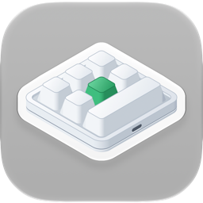

<p align="center"></p>

<h1 align="center">Configurador de teclados de macros para Mac</h1>

<p align="center">
  
  
  
  <a href="../LICENSE"></a>
</p>

<p align="center"><a href="../README.md">English</a> · <a href="README.ko.md">한국어</a> · <a href="README.de.md">Deutsch</a> · <a href="README.es.md">Español</a> · <a href="README.fr.md">Français</a> · <a href="README.id.md">Bahasa Indonesia</a> · <a href="README.it.md">Italiano</a> · <a href="README.ja.md">日本語</a> · <a href="README.pl.md">Polski</a> · <a href="README.pt-BR.md">Português (Brasil)</a> · <b>Português (Portugal)</b> · <a href="README.ru.md">Русский</a> · <a href="README.th.md">ไทย</a> · <a href="README.vi.md">Tiếng Việt</a> · <a href="README.zh-Hans.md">简体中文</a> · <a href="README.zh-Hant.md">繁體中文</a></p>

Uma app para macOS que escreve as definições das teclas em pequenos teclados de macros USB. São vendidos em vários
tamanhos: desde os que têm só um botão rotativo até aos de 21 teclas, com até quatro botões rotativos. Para cada
tecla e cada ação de botão rotativo (rodar para a esquerda, premir, rodar para a direita), a app define nas
camadas 1–3 toques de teclas, uma tecla multimédia ou uma ação do rato, além da iluminação do teclado.

<p align="center"></p>

| Teclado | Disposição | Leitura | Atraso | Iluminação | Testado |
|---|---|---|---|---|---|
| `1189:8890` | definida por si — teclas (até 12), teclas por fila, botões rotativos (até 2) | não | não | três modos | sim — 6 teclas e um botão rotativo |
| fabricante `1189` ou `514C`, produto `8840` · `8842` · `8830`–`8833` · `8850` · `8851`, firmware novo | conforme o que o teclado indica — 26 disposições | ao ligar | antes de cada toque | um modo e uma cor para cada uma das teclas 1–16 | sim — `514C:8850`, 12 teclas e 2 botões rotativos |
| os mesmos, firmware antigo | conforme o que o teclado indica | ao ligar | um por tecla | uma cor e um modo | não |
| os mesmos, sem indicar o tipo | escolhida por si — 26 disposições | não | não | uma cor e um modo | não |

O `1189:8890` é o teclado com que trabalha a ferramenta de configuração para Windows do fabricante, “MINI KeyBoard”;
os restantes são os que a app multiplataforma do fabricante, “MINI_KEYBOARD”, procura. A app utiliza os comandos das
duas ferramentas. A maioria dos teclados do segundo tipo indica quantas teclas e botões rotativos tem e que firmware
utiliza, por isso a app desenha a mesma disposição que a app do fabricante desenharia; para um teclado que não o
indica, utiliza a disposição que escolher entre essas. A app do fabricante não conhece o `1189:8890`, e a própria
ferramenta deste não desenha nenhuma forma, por isso não se sabe qual é a forma real. Assim, indica quantas teclas e
botões rotativos tem e quantas teclas há em cada fila, e a app desenha tudo isso de forma organizada.

A app está disponível em 16 idiomas — inglês, coreano, japonês, chinês (simplificado e tradicional), alemão, espanhol,
francês, italiano, português (Brasil e Portugal), polaco, russo, indonésio, vietnamita e tailandês — e segue as
definições de idioma do macOS. Em qualquer outro idioma, aparece em inglês.

O código-fonte deste repositório está sob a licença MIT. Algumas partes da app distribuída — o nome e o ícone — não
fazem parte deste código. O ícone no topo é mostrado apenas como referência: não está abrangido pela licença MIT, e a
app compilada a partir deste repositório não o inclui.

## macOS, Windows, Linux e a web

O MINIKeyboard tem quatro edições feitas com as mesmas regras — os mesmos comandos, os mesmos 16 idiomas. As três apps aceitam os mesmos teclados, e a edição web, que funciona no navegador, todos menos o `1189:8890`.

| Repositório | GitHub |
|---|---|
| **MINIKeyboardApple**<br>    | [github.com/hobbyworker/MINIKeyboardApple](https://github.com/hobbyworker/MINIKeyboardApple) |
| **MINIKeyboardWin**<br>    | [github.com/hobbyworker/MINIKeyboardWin](https://github.com/hobbyworker/MINIKeyboardWin) |
| **MINIKeyboardLinux**<br>    | [github.com/hobbyworker/MINIKeyboardLinux](https://github.com/hobbyworker/MINIKeyboardLinux) |
| **MINIKeyboardWeb**<br>    | [github.com/hobbyworker/MINIKeyboardWeb](https://github.com/hobbyworker/MINIKeyboardWeb) |

## Transferir

A app assinada e notarizada está em [Releases](https://github.com/hobbyworker/MINIKeyboardApple/releases). Abra
`MINIKeyboard-<versão>.dmg` e arraste o MINIKeyboard para a pasta Aplicações. A app procura atualizações sozinha
(Definições ▸ Geral), e também pode procurar manualmente com **Procurar atualizações…** no menu da app.

## Requisitos

- macOS 14.0 (Sonoma) ou posterior
- O `1189:8890` não precisa de nenhuma permissão: a app escreve diretamente na interface de configuração dele por USB
  e nunca lê o que escreve ao teclado.
- Os restantes teclados são configurados pela primeira interface USB, como faz a app do fabricante. Quando o macOS
  trata essa interface como um teclado, só a abre para apps com permissão de Monitorização de entrada. Enquanto a
  permissão não for concedida, a app avisa e oferece abrir Privacidade e segurança.

## Compilação

```sh
make build          # compila com o Xcode (os avisos são erros)
make package-test   # testes do pacote — a app não abre
make test           # testes da app — a própria app é o anfitrião dos testes
make check          # falha se um ID de equipa entrou no ficheiro do projeto
```

A compilação e os testes foram verificados no Xcode 27.2.

As definições de assinatura e identidade não estão no repositório. Antes da primeira compilação, copie o exemplo e
preencha o seu ID de equipa do Apple Developer, um nome para a app e um ID de pacote próprio. Sem esse ficheiro, a
compilação para em `Unable to open base configuration reference file ... Signing.xcconfig`.

```sh
cp Signing.xcconfig.example Signing.xcconfig
```

O nome do ícone é opcional. Sem a imagem do ícone, a app é compilada com o ícone genérico do sistema.

As atualizações também são opcionais. A app liga o [Sparkle](https://sparkle-project.org) através do Swift Package
Manager — o Xcode transfere-o na primeira compilação —, mas só procura atualizações quando o `Signing.xcconfig` define
tanto um feed (`BRAND_FEED_URL`) como a respetiva chave pública EdDSA (`BRAND_FEED_PUBLIC_KEY`). Sem eles, nenhum
item de atualização aparece em lado nenhum.

Quando o Xcode abre o projeto, troca o nome do produto dentro do esquema partilhado
(`MINIKeyboard.xcodeproj/xcshareddata/xcschemes/`) pelo seu. Isto é normal, e não é preciso fazer commit dessa
alteração.

Os testes da app correm dentro da própria app. Durante os testes, a app procura o teclado e liga-se a ele como
sempre. Os testes do pacote utilizam objetos falsos e teclados simulados, e nunca abrem um teclado.

O menu **Simulador** permite experimentar a app sem o teclado em questão: escolha um `1189:8890`, uma disposição do
firmware mais recente ou um teclado que não indique o tipo, e a app age como se estivesse ligado — com os mesmos
comandos, sem enviar nada por USB. Enquanto estiver em utilização, uma barra laranja no topo da janela avisa, e
**Voltar ao teclado ligado por USB** volta ao teclado real. As compilações Debug oferecem todos os tipos (os outros
IDs do relatório do `1189:8890`, o firmware antigo). **Janela ▸ Registo do dispositivo** mostra todos os relatórios
escritos e todas as respostas.

## Como utilizar

1. Ligue o teclado por USB. A app encontra-o e, se for do segundo tipo, pergunta-lhe que teclado é; se ele
   responder, lê-o de imediato.
2. Na primeira vez, para um teclado que não indica a forma, define a disposição — uma das disposições da app do
   fabricante ou, no `1189:8890`, o número de teclas, de teclas por fila e de botões rotativos — e a posição em que
   fica à sua frente. A app guarda as duas coisas para esse ID USB. Depois, pode alterá-las com **Forma…** e
   **Rodar** (⌘T). Um teclado que indicou a forma só pode ser rodado.
3. Escolha uma camada e, no desenho do teclado, uma tecla ou uma ação de botão rotativo.
4. Atribua uma ação:
   - **Teclas** — mantenha premidas as teclas modificadoras (⌃ ⌥ ⇧ ⌘ e as do lado direito) e clique nas teclas;
     cada clique adiciona um toque. **Só modificadoras** transforma a tecla numa tecla modificadora. **QWERTY**
     dispõe as teclas como num teclado completo e **ABC**, em grupos. Só é possível clicar nas teclas que o teclado
     aceita.
   - **Multimédia**, **Rato** — substituem o que a tecla fazia.
   - **LED** — a iluminação da camada. No firmware novo, escolha uma das teclas 1–16 para lhe dar uma cor.
   - **Atraso** — no firmware que guarda os atrasos.
5. **Guardar** (⌘S) escreve o que mudou. **Ler** (⌘R) obtém a configuração atual dos teclados que permitem a leitura.

Em **Definições** (⌘,), escolhe o idioma da interface (um dos 16 ou o do sistema) e tons claros ou escuros, e em
Informações vê a versão e as licenças de código aberto. Com um feed de atualizações (ver acima),
**Procurar atualizações…** aparece logo abaixo de Definições… no menu da app.

Em **Definições ▸ Geral ▸ Contornar erros do firmware**, **Evitar a repetição de teclas após alterar a iluminação**
vem ativado por predefinição. O firmware do `1189:8890` repete sem parar o primeiro carácter de uma tecla depois de a
iluminação ser guardada (o software do fabricante faz o mesmo), por isso a app envia mais um comando de guardar, sem
nenhuma tecla, depois da iluminação. Desativado, a app envia apenas o mesmo que o software do fabricante. Este
teclado também se esquece da iluminação quando é desligado.

## Estrutura

As regras ficam num pacote Swift local, dividido em três módulos cujas dependências apontam só para dentro: uma
camada que tente alcançar algo de fora não compila.

```
Packages/MINIKeyboardKit/
├── Sources/Domain/        teclados, ações, os controlos de cada disposição e o que cada teclado comporta; os protocolos de repositório; casos de utilização (só Foundation)
├── Sources/DataLayer/     os comandos de cada teclado e a numeração dos controlos; encontrar o teclado e escrever por USB (IOUSBHost) ou HID (IOHIDDevice); teclados simulados
├── Sources/Presentation/  view models e os valores que os ecrãs desenham — a geometria das disposições, tabelas de teclas e cores (Observation, sem SwiftUI)
└── Tests/                 Swift Testing — os bytes de cada comando, as disposições, as edições, o editor
MINIKeyboard/
├── App/                   ponto de entrada e menus da app, a composition root (o único ficheiro que vê Domain e DataLayer), atualizações (Sparkle), licenças
├── Views/                 SwiftUI (só importa Presentation) — o teclado na posição em que fica, as páginas de ação, o painel de disposição, o registo do dispositivo; Settings/
├── Resources/Licenses/    licenças de código aberto, mostradas em Definições ▸ Informações
└── Localizable.xcstrings  en (original), de, es, fr, id, it, ja, ko, pl, pt-BR, pt-PT, ru, th, vi, zh-Hans, zh-Hant
MINIKeyboard-Info.plist    as chaves do Info.plist que o Xcode não consegue gerar — o feed e a chave do Sparkle, a linha de copyright
MINIKeyboardTests/         o interruptor de atualizações, as licenças e o menu da app
```

Zero avisos no Swift 6 é a regra. Os avisos corrigem-se, não se desativam.

## Limitações

- Até agora, a escrita foi testada em dois teclados: um `1189:8890` com seis teclas e um botão rotativo — que afinal
  tem uma única camada: o que é escrito em qualquer camada vai para o mesmo sítio — e um `514C:8850` com doze teclas
  e dois botões rotativos, com firmware novo. Os restantes teclados são escritos como a app do fabricante os escreve;
  os testes fixam os bytes, mas nenhum deles foi ainda testado num teclado real.
- O `1189:8890` e os teclados que não indicam o tipo não conseguem indicar a configuração atual, por isso a app mostra
  só o que foi definido nela.
- Um teclado aberto de cada vez. Com vários ligados, o botão ao lado do estado da ligação escolhe qual; a app abre o
  escolhido da última vez ou, se não houver, o primeiro que encontrar — um `1189:8890` primeiro.
- Não há ações para mover o rato nem para arrastar.
