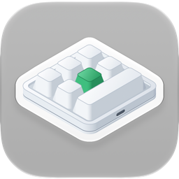

<p align="center"></p>

<h1 align="center">Конфигуратор макроклавиатур для Mac</h1>

<p align="center">
  
  
  
  <a href="../LICENSE"></a>
</p>

<p align="center"><a href="../README.md">English</a> · <a href="README.ko.md">한국어</a> · <a href="README.de.md">Deutsch</a> · <a href="README.es.md">Español</a> · <a href="README.es-419.md">Español (Latinoamérica)</a> · <a href="README.fr.md">Français</a> · <a href="README.id.md">Bahasa Indonesia</a> · <a href="README.it.md">Italiano</a> · <a href="README.ja.md">日本語</a> · <a href="README.pl.md">Polski</a> · <a href="README.pt-BR.md">Português (Brasil)</a> · <a href="README.pt-PT.md">Português (Portugal)</a> · <b>Русский</b> · <a href="README.th.md">ไทย</a> · <a href="README.vi.md">Tiếng Việt</a> · <a href="README.zh-Hans.md">简体中文</a> · <a href="README.zh-Hant.md">繁體中文</a></p>

Приложение для macOS, которое записывает настройки клавиш в маленькие USB-макроклавиатуры. Такие клавиатуры продаются
в самых разных вариантах — от одной-единственной ручки до 21 клавиши, а ручек у них бывает до четырёх. Для каждой
клавиши и каждого действия ручки (поворот влево, нажатие, поворот вправо) приложение задаёт на слоях 1–3 нажатия
клавиш, медиаклавишу или действие мыши, а также подсветку клавиатуры.

<p align="center"></p>

| Клавиатура | Компоновка | Считывание | Задержки | Подсветка | Проверено |
|---|---|---|---|---|---|
| `1189:8890` | задаёте вы — клавиши (до 12), клавиш в ряду, ручки (до 2) | нет | нет | три режима | да — 6 клавиш и ручка |
| производитель `1189` или `514C`, продукт `8840` · `8842` · `8830`–`8833` · `8850` · `8851`, новая прошивка | по данным клавиатуры — 26 компоновок | сразу при подключении | перед каждым нажатием | режим и цвет для каждой из клавиш 1–16 | да — `514C:8850`, 12 клавиш и 2 ручки |
| те же, старая прошивка | по данным клавиатуры | сразу при подключении | одна на клавишу | цвет и режим | нет |
| те же, не сообщающие свой тип | выбираете вы — 26 компоновок | нет | нет | цвет и режим | нет |

Клавиатура `1189:8890` — та, с которой работает утилита производителя для Windows «MINI KeyBoard»; остальные — те,
которые ищет кроссплатформенное приложение производителя «MINI_KEYBOARD». Приложение использует команды обоих
инструментов. Большинство клавиатур второго вида сообщают, сколько у них клавиш и ручек и какая у них прошивка,
и приложение рисует ту же компоновку, что нарисовало бы приложение производителя; для клавиатуры, которая этого не
сообщает, используется выбранная вами компоновка из их числа. Приложение производителя не знает `1189:8890`,
а собственная утилита этой клавиатуры не рисует никакой формы, поэтому её настоящая форма неизвестна: вы указываете,
сколько у неё клавиш и ручек и сколько клавиш в ряду, а приложение аккуратно рисует именно такое расположение.

Приложение доступно на 17 языках — английском, корейском, японском, китайском (упрощённом и традиционном), немецком,
испанском (Испания и Латинская Америка), французском, итальянском, португальском (Бразилия и Португалия), польском,
русском, индонезийском, вьетнамском и тайском — и следует языковым настройкам macOS. Для остальных языков используется
английский.

Исходный код в этом репозитории распространяется по лицензии MIT. Некоторые части распространяемого приложения — его
название и значок — в этот код не входят. Значок вверху показан только для наглядности: на него не распространяется
лицензия MIT, и в сборки из этого репозитория он не входит.

## macOS, Windows, Linux и веб

MINIKeyboard выходит в четырёх версиях, созданных по одним и тем же правилам, — те же команды, те же 17 языков. Три приложения поддерживают одни и те же клавиатуры, а веб-версия, работающая в браузере, — все, кроме `1189:8890`.

| Репозиторий | GitHub |
|---|---|
| **MINIKeyboardApple**<br>    | [github.com/hobbyworker/MINIKeyboardApple](https://github.com/hobbyworker/MINIKeyboardApple) |
| **MINIKeyboardWin**<br>    | [github.com/hobbyworker/MINIKeyboardWin](https://github.com/hobbyworker/MINIKeyboardWin) |
| **MINIKeyboardLinux**<br>    | [github.com/hobbyworker/MINIKeyboardLinux](https://github.com/hobbyworker/MINIKeyboardLinux) |
| **MINIKeyboardWeb**<br>    | [github.com/hobbyworker/MINIKeyboardWeb](https://github.com/hobbyworker/MINIKeyboardWeb) |

## Загрузка

Подписанное и прошедшее нотаризацию приложение находится на странице
[Releases](https://github.com/hobbyworker/MINIKeyboardApple/releases): откройте `MINIKeyboard-<версия>.dmg`
и перетащите MINIKeyboard в папку «Программы». Приложение само проверяет наличие обновлений (Настройки ▸ Основные),
а проверить вручную можно командой **Проверить наличие обновлений…** в меню приложения.

## Требования

- macOS 14.0 (Sonoma) или новее
- Клавиатуре `1189:8890` никакие разрешения не нужны: приложение записывает данные напрямую в её интерфейс настройки
  по USB и никогда не читает то, что вы набираете.
- Остальные клавиатуры настраиваются через свой первый USB-интерфейс, как это делает приложение производителя. Если
  macOS принимает этот интерфейс за клавиатуру, доступ к нему приложение получает только с разрешением
  «Мониторинг ввода»; пока разрешения нет, приложение сообщает об этом и предлагает открыть
  «Конфиденциальность и безопасность».

## Сборка

```sh
make build          # сборка через Xcode (предупреждения считаются ошибками)
make package-test   # тесты пакета — приложение не запускается
make test           # тесты приложения, их хост — само приложение
make check          # ошибка, если в файл проекта попал ID команды
```

Сборка и тесты проверены в Xcode 27.2.

Настроек подписи и идентификации в репозитории нет. Перед первой сборкой скопируйте пример и укажите свой ID команды
Apple Developer, название приложения и собственный bundle ID. Без этого файла сборка останавливается на
`Unable to open base configuration reference file ... Signing.xcconfig`.

```sh
cp Signing.xcconfig.example Signing.xcconfig
```

Название значка указывать необязательно. Без изображения значка приложение получает стандартный значок системы.

Обновления тоже необязательны. Приложение подключает [Sparkle](https://sparkle-project.org) через
Swift Package Manager — Xcode загружает его при первой сборке, — но проверяет наличие обновлений, только если
в `Signing.xcconfig` указаны и канал обновлений (`BRAND_FEED_URL`), и его открытый ключ EdDSA
(`BRAND_FEED_PUBLIC_KEY`). Без них в приложении нигде нет пунктов, связанных с обновлениями.

Когда Xcode открывает проект, он заменяет название продукта в общей схеме
(`MINIKeyboard.xcodeproj/xcshareddata/xcschemes/`) на ваше. Это нормально, коммитить это изменение не нужно.

Хостом тестов приложения служит само приложение. Пока они выполняются, приложение, как обычно, ищет клавиатуру
и подключается к ней. Тесты пакета используют заглушки и клавиатуры симулятора и никогда не открывают клавиатуру.

Меню **Симулятор** позволяет попробовать приложение без самой клавиатуры: выберите `1189:8890`, компоновку на новой
прошивке или клавиатуру, которая не сообщает свой тип, и приложение будет вести себя так, будто она подключена, —
с теми же командами, но ничего не отправляя по USB. Пока симулятор используется, об этом сообщает оранжевая полоса
вверху окна, а **Вернуться к USB-клавиатуре** возвращает к настоящей клавиатуре. В сборках Debug доступны все варианты
(другие ID отчёта `1189:8890`, старая прошивка). **Окно ▸ Журнал устройства** показывает все записанные отчёты и все
ответы.

## Использование

1. Подключите клавиатуру по USB. Приложение находит её, а у клавиатуры второго вида запрашивает тип; если клавиатура
   отвечает, её настройки сразу считываются.
2. Если клавиатура не сообщает свою форму, в первый раз приложение просит выбрать компоновку — одну из компоновок
   приложения производителя, а для `1189:8890` число клавиш, клавиш в ряду и ручек — и то, как клавиатура лежит перед
   вами. Приложение запоминает и то и другое для этого USB ID. Позже их можно изменить командами **Форма…**
   и **Повернуть** (⌘T); клавиатуру, которая сообщила свою форму, можно только поворачивать.
3. Выберите слой, а затем на изображении клавиатуры — клавишу или действие ручки.
4. Назначьте действие:
   - **Клавиши** — удерживайте модификаторы (⌃ ⌥ ⇧ ⌘, а также правые) и щёлкайте по клавишам; каждый щелчок добавляет
     нажатие. **Только модификаторы** превращает клавишу в клавишу-модификатор. **QWERTY** располагает клавиши как на
     полноразмерной клавиатуре, **ABC** — группами; щёлкнуть можно только по тем клавишам, которые принимает
     клавиатура.
   - **Мультимедиа**, **Мышь** — заменяют прежнее действие клавиши.
   - **LED** — подсветка слоя; на новой прошивке выберите одну из клавиш 1–16, чтобы задать ей цвет.
   - **Задержка** — на прошивке, которая хранит задержки.
5. **Сохранить** (⌘S) записывает изменения. **Считать** (⌘R) получает текущие настройки с клавиатуры, которая
   поддерживает считывание.

**Настройки** (⌘,) позволяют выбрать язык интерфейса (один из 17 или язык системы) и светлое или тёмное оформление,
а в разделе «О приложении» показаны версия и лицензии открытого ПО. Если есть канал обновлений (см. выше), команда
**Проверить наличие обновлений…** находится в меню приложения сразу под пунктом «Настройки…».

В разделе **Настройки ▸ Основные ▸ Обход ошибок прошивки** параметр
**Предотвращать повтор клавиш после изменения подсветки** по умолчанию включён. После сохранения подсветки прошивка
`1189:8890` бесконечно повторяет первый символ клавиши — с программой производителя происходит то же самое, — поэтому
после подсветки приложение отправляет ещё одну команду сохранения, без клавиш. Если параметр выключен, приложение
отправляет только то же, что и программа производителя. Кроме того, эта клавиатура забывает подсветку, когда её
отключают.

## Структура

Правила находятся в локальном пакете Swift, в трёх модулях, зависимости которых направлены только внутрь, — слой,
который тянется наружу, не компилируется.

```
Packages/MINIKeyboardKit/
├── Sources/Domain/        клавиатуры, действия, элементы управления каждой компоновки и то, что может хранить каждая клавиатура; протоколы репозиториев; сценарии использования (только Foundation)
├── Sources/DataLayer/     команды каждой клавиатуры и нумерация её элементов управления; поиск клавиатуры и запись по USB (IOUSBHost) или HID (IOHIDDevice); клавиатуры симулятора
├── Sources/Presentation/  модели представления и значения, которые рисуют экраны, — геометрия компоновок, таблицы клавиш и цветов (Observation, без SwiftUI)
└── Tests/                 Swift Testing — байты каждой команды, компоновки, правки, редактор
MINIKeyboard/
├── App/                   точка входа и меню приложения, composition root (единственный файл, который видит Domain и DataLayer), обновления (Sparkle), лицензии
├── Views/                 SwiftUI (импортирует только Presentation) — клавиатура в том положении, в каком она лежит, вкладки действий, окно выбора компоновки, журнал устройства; Settings/
├── Resources/Licenses/    лицензии открытого ПО, которые показываются в разделе Настройки ▸ О приложении
└── Localizable.xcstrings  en (исходный), de, es, fr, id, it, ja, ko, pl, pt-BR, pt-PT, ru, th, vi, zh-Hans, zh-Hant
MINIKeyboard-Info.plist    ключи Info.plist, которые Xcode не может сгенерировать, — канал и ключ Sparkle, строка об авторских правах
MINIKeyboardTests/         переключатель обновлений, лицензии и меню приложения
```

Ноль предупреждений в Swift 6 — обязательное требование. Предупреждения исправляют, а не отключают.

## Ограничения

- Запись пока проверена на двух клавиатурах: `1189:8890` с шестью клавишами и ручкой — у неё, как оказалось, всего
  один слой: на какой слой ни записать, запись попадает в одно и то же место — и `514C:8850` с двенадцатью клавишами
  и двумя ручками на новой прошивке. Остальные клавиатуры записываются так же, как их записывает приложение
  производителя; тесты фиксируют байты, но ни одну из этих клавиатур ещё не проверяли на реальном устройстве.
- Клавиатура `1189:8890` и те, что не сообщают свой тип, не могут передать свои настройки, поэтому приложение
  показывает только то, что было задано в нём самом.
- Одновременно открыта только одна клавиатура. Если подключено несколько, нужную выбирают кнопкой рядом с состоянием
  подключения; приложение открывает ту, что была выбрана в прошлый раз, а если такой нет — первую найденную, причём
  сначала `1189:8890`.
- Перемещения мыши и перетаскивания нет.
