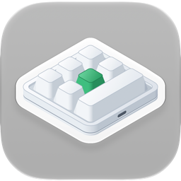

<p align="center"></p>

<h1 align="center">เครื่องมือตั้งค่าแป้นพิมพ์มาโครสำหรับ Mac</h1>

<p align="center">
  
  
  
  <a href="../LICENSE"></a>
</p>

<p align="center"><a href="../README.md">English</a> · <a href="README.ko.md">한국어</a> · <a href="README.de.md">Deutsch</a> · <a href="README.es.md">Español</a> · <a href="README.fr.md">Français</a> · <a href="README.id.md">Bahasa Indonesia</a> · <a href="README.it.md">Italiano</a> · <a href="README.ja.md">日本語</a> · <a href="README.pl.md">Polski</a> · <a href="README.pt-BR.md">Português (Brasil)</a> · <a href="README.pt-PT.md">Português (Portugal)</a> · <a href="README.ru.md">Русский</a> · <b>ไทย</b> · <a href="README.vi.md">Tiếng Việt</a> · <a href="README.zh-Hans.md">简体中文</a> · <a href="README.zh-Hant.md">繁體中文</a></p>

แอป macOS ที่เขียนการตั้งค่าปุ่มลงในแป้นพิมพ์มาโคร USB ขนาดเล็ก — แบบที่วางขายตั้งแต่รุ่นที่มีปุ่มหมุนเพียงปุ่มเดียวไปจนถึงรุ่นที่มีปุ่ม 21 ปุ่ม และมีปุ่มหมุนได้สูงสุดสี่ปุ่ม สำหรับปุ่มแต่ละปุ่มและการทำงานแต่ละแบบของปุ่มหมุน (หมุนซ้าย, กด, หมุนขวา) แอปจะกำหนดการกดปุ่ม ปุ่มสื่อ หรือการทำงานของเมาส์ในเลเยอร์ 1–3 และตั้งค่าแสงไฟของแป้นพิมพ์ได้ด้วย

<p align="center"></p>

| แป้นพิมพ์ | เลย์เอาต์ | อ่านค่ากลับ | หน่วงเวลา | แสงไฟ | ทดสอบกับเครื่องจริง |
|---|---|---|---|---|---|
| `1189:8890` | คุณจัดเอง — ปุ่ม (สูงสุด 12), ปุ่มต่อแถว, ปุ่มหมุน (สูงสุด 2) | ไม่ได้ | ไม่มี | สามโหมด | ทดสอบแล้ว — ปุ่ม 6 ปุ่มและปุ่มหมุน 1 ปุ่ม |
| ผู้ผลิต `1189` หรือ `514C`, ผลิตภัณฑ์ `8840` · `8842` · `8830`–`8833` · `8850` · `8851`, เฟิร์มแวร์รุ่นใหม่ | ตามที่แป้นพิมพ์แจ้ง — 26 เลย์เอาต์ | ทันทีที่เชื่อมต่อ | ก่อนการกดแต่ละครั้ง | หนึ่งโหมด และสีของปุ่ม 1–16 แต่ละปุ่ม | ทดสอบแล้ว — `514C:8850`, ปุ่ม 12 ปุ่มและปุ่มหมุน 2 ปุ่ม |
| แป้นพิมพ์กลุ่มเดียวกัน, เฟิร์มแวร์รุ่นเก่า | ตามที่แป้นพิมพ์แจ้ง | ทันทีที่เชื่อมต่อ | ปุ่มละหนึ่งค่า | สีและโหมด | ยังไม่ได้ทดสอบ |
| แป้นพิมพ์กลุ่มเดียวกันที่ไม่บอกประเภท | คุณเลือกเอง — 26 เลย์เอาต์ | ไม่ได้ | ไม่มี | สีและโหมด | ยังไม่ได้ทดสอบ |

`1189:8890` คือแป้นพิมพ์ที่เครื่องมือตั้งค่าบน Windows ของผู้ผลิต “MINI KeyBoard” รองรับ ส่วนแป้นพิมพ์อื่นคือแป้นพิมพ์ที่แอปข้ามแพลตฟอร์มของผู้ผลิต “MINI_KEYBOARD” ค้นหา แอปนี้ใช้คำสั่งของเครื่องมือทั้งสอง แป้นพิมพ์กลุ่มที่สองส่วนใหญ่จะบอกว่ามีปุ่มและปุ่มหมุนกี่ปุ่ม และใช้เฟิร์มแวร์แบบใด แอปจึงวาดเลย์เอาต์แบบเดียวกับที่แอปของผู้ผลิตวาด ส่วนแป้นพิมพ์ที่ไม่บอกจะใช้เลย์เอาต์ที่คุณเลือกจากเลย์เอาต์เหล่านั้น แอปของผู้ผลิตไม่รู้จัก `1189:8890` และเครื่องมือของแป้นพิมพ์นี้เองก็ไม่ได้วาดรูปทรงไว้ จึงไม่ทราบรูปทรงจริงของแป้นพิมพ์ เพียงบอกแอปว่ามีปุ่มและปุ่มหมุนกี่ปุ่ม และแถวหนึ่งมีกี่ปุ่ม แอปก็จะวาดให้เป็นระเบียบตามนั้น

แอปมีให้ใช้ 16 ภาษา ได้แก่ อังกฤษ เกาหลี ญี่ปุ่น จีน (ตัวย่อและตัวเต็ม) เยอรมัน สเปน ฝรั่งเศส อิตาลี โปรตุเกส (บราซิลและโปรตุเกส) โปแลนด์ รัสเซีย อินโดนีเซีย เวียดนาม และไทย โดยจะแสดงตามการตั้งค่าภาษาของ macOS ส่วนภาษาอื่นจะแสดงเป็นภาษาอังกฤษ

ซอร์สโค้ดในที่เก็บนี้ใช้สัญญาอนุญาต MIT บางส่วนของแอปที่เผยแพร่ไม่ได้อยู่ในซอร์สนี้ ได้แก่ ชื่อและไอคอนของแอป ไอคอนด้านบนแสดงไว้เพื่ออ้างอิงเท่านั้น ไม่อยู่ภายใต้สัญญาอนุญาต MIT และบิลด์จากที่เก็บนี้ไม่มีไอคอนนี้

## macOS, Windows, Linux และเว็บ

MINIKeyboard มีสี่รุ่นที่สร้างตามกฎเดียวกัน — ใช้คำสั่งเดียวกันและมี 16 ภาษาเหมือนกัน แอปทั้งสามรองรับแป้นพิมพ์ชุดเดียวกัน ส่วนรุ่นเว็บซึ่งทำงานในเบราว์เซอร์รองรับแป้นพิมพ์ทั้งหมดนั้นยกเว้น `1189:8890`

| ที่เก็บ | GitHub |
|---|---|
| **MINIKeyboardApple**<br>    | [github.com/hobbyworker/MINIKeyboardApple](https://github.com/hobbyworker/MINIKeyboardApple) |
| **MINIKeyboardWin**<br>    | [github.com/hobbyworker/MINIKeyboardWin](https://github.com/hobbyworker/MINIKeyboardWin) |
| **MINIKeyboardLinux**<br>    | [github.com/hobbyworker/MINIKeyboardLinux](https://github.com/hobbyworker/MINIKeyboardLinux) |
| **MINIKeyboardWeb**<br>    | [github.com/hobbyworker/MINIKeyboardWeb](https://github.com/hobbyworker/MINIKeyboardWeb) |

## ดาวน์โหลด

แอปที่ลงนามและผ่านการรับรองแล้วอยู่ในหน้า [Releases](https://github.com/hobbyworker/MINIKeyboardApple/releases) เปิด `MINIKeyboard-<เวอร์ชั่น>.dmg` แล้วลาก MINIKeyboard ไปไว้ในโฟลเดอร์ “แอปพลิเคชัน” แอปจะตรวจหารายการอัปเดตเอง (การตั้งค่า ▸ ทั่วไป) หรือจะเลือก **ตรวจหารายการอัปเดต…** ในเมนูแอปก็ได้

## ข้อกำหนด

- macOS 14.0 (Sonoma) ขึ้นไป
- `1189:8890` ไม่ต้องขอสิทธิ์ใดๆ แอปเขียนลงช่องทางการตั้งค่าของแป้นพิมพ์นี้โดยตรงผ่าน USB และไม่อ่านสิ่งที่คุณพิมพ์เลย
- สำหรับแป้นพิมพ์อื่น แอปตั้งค่าผ่านอินเทอร์เฟซ USB ตัวแรก เช่นเดียวกับแอปของผู้ผลิต หาก macOS ถือว่าอินเทอร์เฟซนั้นเป็นแป้นพิมพ์ macOS จะเปิดอินเทอร์เฟซนั้นให้เฉพาะแอปที่ได้รับอนุญาตใน “การตรวจสอบสัญญาณเข้า” แล้วเท่านั้น ระหว่างที่ยังไม่ได้รับอนุญาต แอปจะแจ้งให้ทราบและเสนอให้เปิด “ความเป็นส่วนตัวและความปลอดภัย”

## การบิลด์

```sh
make build          # บิลด์ผ่าน Xcode (คำเตือนถือเป็นข้อผิดพลาด)
make package-test   # การทดสอบของ package — แอปไม่เปิดขึ้นมา
make test           # การทดสอบของแอป โดยมีแอปเป็นโฮสต์
make check          # ล้มเหลวถ้ามี Team ID หลุดเข้าไปในไฟล์โปรเจกต์
```

การบิลด์และการทดสอบตรวจสอบแล้วกับ Xcode 27.2

การตั้งค่าการลงนามและข้อมูลระบุตัวตนไม่ได้อยู่ในที่เก็บ ก่อนบิลด์ครั้งแรก ให้คัดลอกไฟล์ตัวอย่างแล้วกรอก Team ID ของ Apple Developer, ชื่อแอป และ Bundle ID ของคุณเอง ถ้าไม่มีไฟล์นี้ การบิลด์จะหยุดที่ `Unable to open base configuration reference file ... Signing.xcconfig`

```sh
cp Signing.xcconfig.example Signing.xcconfig
```

ชื่อไอคอนจะใส่หรือไม่ก็ได้ ถ้าไม่มีภาพไอคอน แอปจะใช้ไอคอนทั่วไปของระบบ

การอัปเดตก็เป็นตัวเลือกเช่นกัน แอปลิงก์กับ [Sparkle](https://sparkle-project.org) ผ่าน Swift Package Manager — Xcode จะดึงมาในการบิลด์ครั้งแรก — แต่จะตรวจหารายการอัปเดตก็ต่อเมื่อ `Signing.xcconfig` ระบุทั้งฟีด (`BRAND_FEED_URL`) และคีย์สาธารณะ EdDSA ของฟีดนั้น (`BRAND_FEED_PUBLIC_KEY`) ถ้าไม่มี แอปจะไม่มีรายการอัปเดตที่ใดเลย

เมื่อ Xcode เปิดโปรเจกต์ จะเขียนชื่อผลิตภัณฑ์ใน scheme ที่ใช้ร่วมกัน (`MINIKeyboard.xcodeproj/xcshareddata/xcschemes/`) ใหม่เป็นชื่อของคุณ ซึ่งเป็นเรื่องปกติ และไม่จำเป็นต้อง commit

การทดสอบของแอปใช้ตัวแอปเองเป็นโฮสต์ ระหว่างทดสอบ แอปจะค้นหาและเชื่อมต่อแป้นพิมพ์ตามปกติ ส่วนการทดสอบของ package ใช้ของปลอมและแป้นพิมพ์จำลอง และไม่เปิดแป้นพิมพ์ใดเลย

เมนู **โปรแกรมจำลอง** ช่วยให้ลองใช้แอปได้โดยไม่ต้องมีแป้นพิมพ์รุ่นนั้น เลือก `1189:8890`, เลย์เอาต์ของเฟิร์มแวร์รุ่นใหม่ หรือแป้นพิมพ์ที่ไม่บอกประเภท แล้วแอปจะทำงานเหมือนมีแป้นพิมพ์เสียบอยู่ — ด้วยคำสั่งเดียวกัน โดยไม่มีอะไรส่งออกไปทาง USB ระหว่างใช้งาน แถบสีส้มที่ด้านบนของหน้าต่างจะแจ้งให้ทราบ และ **กลับไปใช้แป้นพิมพ์ที่เชื่อมต่อผ่าน USB** จะพากลับมา บิลด์ Debug มีให้เลือกทุกแบบ (Report ID อื่นของ `1189:8890` และเฟิร์มแวร์รุ่นเก่า) **หน้าต่าง ▸ ประวัติอุปกรณ์** แสดงรีพอร์ตทุกรายการที่เขียนไปและคำตอบทุกรายการ

## วิธีใช้

1. เชื่อมต่อแป้นพิมพ์ผ่าน USB แอปจะค้นหาแป้นพิมพ์ และถามประเภทจากแป้นพิมพ์กลุ่มที่สอง ถ้าแป้นพิมพ์ตอบ แอปจะอ่านค่าทันที
2. แป้นพิมพ์ที่ไม่บอกรูปทรงจะให้เลือกเลย์เอาต์ในครั้งแรก — หนึ่งในเลย์เอาต์ของแอปผู้ผลิต หรือสำหรับ `1189:8890` คือจำนวนปุ่ม, ปุ่มต่อแถว และปุ่มหมุน — รวมถึงทิศทางที่แป้นพิมพ์วางอยู่ตรงหน้าคุณ แอปจะจำทั้งสองอย่างไว้ตาม USB ID นั้น เปลี่ยนภายหลังได้ด้วย **รูปทรง…** และ **หมุน** (⌘T) ส่วนแป้นพิมพ์ที่บอกรูปทรงแล้วจะหมุนได้อย่างเดียว
3. เลือกเลเยอร์ แล้วเลือกปุ่มหรือการทำงานของปุ่มหมุนบนภาพแป้นพิมพ์
4. กำหนดการทำงาน:
   - **ปุ่ม** — กดปุ่มปรับค่าค้างไว้ (⌃ ⌥ ⇧ ⌘ และปุ่มทางด้านขวา) แล้วคลิกปุ่ม การคลิกแต่ละครั้งจะเพิ่มการกดหนึ่งครั้ง **ปุ่มปรับค่าเท่านั้น** ทำให้ปุ่มนั้นกลายเป็นปุ่มปรับค่า **QWERTY** เรียงปุ่มแบบแป้นพิมพ์ขนาดเต็ม ส่วน **ABC** เรียงเป็นกลุ่ม คลิกได้เฉพาะปุ่มที่แป้นพิมพ์รองรับ
   - **มัลติมีเดีย**, **เมาส์** — แทนที่สิ่งที่ปุ่มเคยทำ
   - **LED** — แสงไฟของเลเยอร์ ในเฟิร์มแวร์รุ่นใหม่ ให้เลือกปุ่มใดปุ่มหนึ่งจากปุ่ม 1–16 เพื่อกำหนดสีให้ปุ่มนั้น
   - **หน่วงเวลา** — สำหรับเฟิร์มแวร์ที่เก็บค่าหน่วงเวลาได้
5. **บันทึก** (⌘S) จะเขียนสิ่งที่เปลี่ยนแปลง **อ่าน** (⌘R) จะดึงการตั้งค่าปัจจุบันจากแป้นพิมพ์ที่อ่านค่าได้

**การตั้งค่า** (⌘,) ใช้เลือกภาษาที่แอปแสดง (หนึ่งใน 16 ภาษา หรือภาษาของระบบ) และรูปแบบสว่างหรือมืด ส่วน “เกี่ยวกับ” แสดงเวอร์ชั่นและสัญญาอนุญาตโอเพนซอร์ส ถ้ามีฟีดอัปเดต (ดูด้านบน) **ตรวจหารายการอัปเดต…** จะอยู่ใต้ “การตั้งค่า…” ในเมนูแอปพอดี

ใน **การตั้งค่า ▸ ทั่วไป ▸ วิธีเลี่ยงข้อบกพร่องของเฟิร์มแวร์** มี **ป้องกันการกดปุ่มซ้ำหลังเปลี่ยนแสงไฟ** ซึ่งเปิดไว้เป็นค่าเริ่มต้น หลังบันทึกแสงไฟ เฟิร์มแวร์ของ `1189:8890` จะพิมพ์อักขระแรกของปุ่มซ้ำไม่หยุด — ซอฟต์แวร์ของผู้ผลิตก็เป็นเช่นนี้ — แอปจึงส่งคำสั่งบันทึกอีกหนึ่งครั้งหลังแสงไฟ โดยไม่มีปุ่มใดอยู่ในนั้น เมื่อปิด แอปจะส่งเฉพาะสิ่งที่ซอฟต์แวร์ของผู้ผลิตส่ง นอกจากนี้ แป้นพิมพ์นี้ยังลืมการตั้งค่าแสงไฟเมื่อถอดออกด้วย

## โครงสร้าง

กฎทั้งหมดอยู่ใน Swift package ภายในเครื่อง แบ่งเป็นสามโมดูลที่การพึ่งพาชี้เข้าด้านในเท่านั้น — เลเยอร์ที่เอื้อมออกไปด้านนอกจะคอมไพล์ไม่ผ่าน

```
Packages/MINIKeyboardKit/
├── Sources/Domain/        แป้นพิมพ์, การทำงาน, ตัวควบคุมของแต่ละเลย์เอาต์ และสิ่งที่แต่ละแป้นพิมพ์เก็บได้; โปรโตคอลของ repository; use case (Foundation เท่านั้น)
├── Sources/DataLayer/     คำสั่งของแต่ละแป้นพิมพ์และหมายเลขที่ตัวควบคุมใช้; การค้นหาแป้นพิมพ์และการเขียนผ่าน USB (IOUSBHost) หรือ HID (IOHIDDevice); แป้นพิมพ์จำลอง
├── Sources/Presentation/  view model และค่าที่หน้าจอวาด — รูปทรงเรขาคณิตของเลย์เอาต์, ตารางปุ่มและสี (Observation, ไม่มี SwiftUI)
└── Tests/                 Swift Testing — ไบต์ของทุกคำสั่ง, เลย์เอาต์, การแก้ไข, ตัวแก้ไข
MINIKeyboard/
├── App/                   จุดเริ่มต้นของแอปและเมนู, composition root (ไฟล์เดียวที่เห็น Domain และ DataLayer), การอัปเดต (Sparkle), สัญญาอนุญาต
├── Views/                 SwiftUI (import เฉพาะ Presentation) — แป้นพิมพ์ตามที่วางอยู่, หน้าการทำงาน, ชีตเลย์เอาต์, ประวัติอุปกรณ์; Settings/
├── Resources/Licenses/    สัญญาอนุญาตโอเพนซอร์สที่แสดงใน การตั้งค่า ▸ เกี่ยวกับ
└── Localizable.xcstrings  en (ต้นฉบับ), de, es, fr, id, it, ja, ko, pl, pt-BR, pt-PT, ru, th, vi, zh-Hans, zh-Hant
MINIKeyboard-Info.plist    คีย์ Info.plist ที่ Xcode สร้างเองไม่ได้ — ฟีดและคีย์ของ Sparkle, บรรทัดลิขสิทธิ์
MINIKeyboardTests/         สวิตช์การอัปเดต, สัญญาอนุญาต และเมนูแอป
```

เกณฑ์คือไม่มีคำเตือนเลยภายใต้ Swift 6 คำเตือนต้องแก้ ไม่ใช่ปิดไว้

## ข้อจำกัด

- จนถึงตอนนี้ได้ทดสอบการเขียนกับแป้นพิมพ์ 2 ตัว ได้แก่ `1189:8890` ที่มีปุ่ม 6 ปุ่มและปุ่มหมุน 1 ปุ่ม — ซึ่งปรากฏว่ามีเลเยอร์เดียว เขียนลงเลเยอร์ใดก็ได้ผลเหมือนกัน — และ `514C:8850` ที่มีปุ่ม 12 ปุ่มและปุ่มหมุน 2 ปุ่ม บนเฟิร์มแวร์รุ่นใหม่ ส่วนแป้นพิมพ์อื่น แอปจะเขียนแบบเดียวกับที่แอปของผู้ผลิตเขียน มีการทดสอบยืนยันไบต์ไว้ แต่ยังไม่ได้ทดสอบกับแป้นพิมพ์จริงเลยสักตัว
- `1189:8890` และแป้นพิมพ์ที่ไม่บอกประเภทไม่สามารถแจ้งการตั้งค่าปัจจุบันได้ แอปจึงแสดงเฉพาะสิ่งที่ตั้งไว้ในแอป
- เปิดแป้นพิมพ์ได้ทีละตัว ถ้าเสียบไว้หลายตัว ให้เลือกด้วยปุ่มข้างสถานะการเชื่อมต่อ แอปจะเปิดตัวที่เลือกไว้ครั้งก่อน หรือถ้าไม่มี ก็จะเปิดตัวแรกที่พบ โดย `1189:8890` มาก่อน
- ไม่รองรับการเลื่อนเมาส์และการลาก
